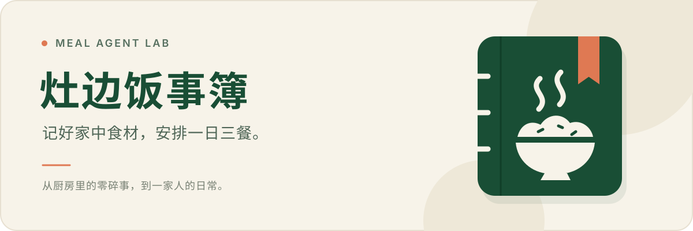

<p align="center">
  
</p>

<div align="center">

**一个从家庭食材与用餐档案出发的膳食规划实验项目。**


[项目介绍](#让一日三餐更有着落) · [当前能力](#已经有了什么) · [本地体验](#在本地试一试) · [技术设计](#技术设计) · [文档](#继续了解)

</div>

<br />

## 让一日三餐，更有着落

打开冰箱，却想不起哪些食材该先吃；准备做饭，才发现少了一样配料；买菜时，又忘了家里还剩什么。

**灶边饭事簿**想把这些零碎的小事记清楚：家里有什么、谁来吃饭、有哪些需要照顾的习惯，再一步步连接到一餐安排、采购和实际消耗。少一些临时纠结，也让厨房里的每一份食材更容易被看见。

| 记清食材 | 照顾家人 | 安排一餐 |
| :--- | :--- | :--- |
| 按批次记录库存与变化，留下每次消耗的来龙去脉。 | 整理用餐档案、偏好与硬约束，让共享有边界。 | 逐步连接菜单、采购与餐后记录，让计划落到日常。 |

> **项目进度**：公开主线已具备家庭、档案和基础库存能力。一餐规划与执行闭环仍在独立开发分支或本地工作树中探索。

## 已经有了什么

| 能力 | 你可以做什么 |
| :--- | :--- |
| **家庭协作** | 创建家庭、通过邀请码加入、查看和管理成员。 |
| **用餐档案** | 管理关联成员或仅用餐档案，编辑、归档与恢复。 |
| **饮食约束** | 登记过敏及其他硬约束，确认信息并控制可见范围。 |
| **批次库存** | 新增食材批次，以事件记录精确消耗。 |
| **操作恢复** | 请求结果未知时，在当前进程内用原始操作和同一幂等键重试。 |
| **本地部署** | 使用 Compose 启动本地环境，执行健康检查、备份与恢复演练。 |

主线已完成阶段 08 家庭与档案基础、阶段 09A 本地部署基线验收。完整进度和证据见[项目状态](docs/project-status.md)。

> [!IMPORTANT]
> 当前体验面向**本地开发与合成数据验证**。真实微信登录、真机、外部测试和产品发布尚未开放。食材、过敏原等权威映射尚未完成，硬约束保持待映射状态，不能据此生成真实食品建议。

## 在本地试一试

准备 **Node.js 24.18.0**、**pnpm 11.9.0**、**PostgreSQL 18.4** 和微信开发者工具。环境检查会核对数据库工具；需要时通过 `PG_BIN` 指向 PostgreSQL 的 `bin` 目录。

**① 获取项目，检查环境**

```bash
git clone https://github.com/aning0922/meal-agent-lab.git
cd meal-agent-lab
corepack enable
pnpm install --frozen-lockfile
pnpm --filter @meal-agent/api environment:check
pnpm --filter @meal-agent/contracts build
```

**② 启动本地 API**

```bash
MEAL_AGENT_DEV_API_PORT=3000 pnpm --filter @meal-agent/client dev:stack
```

命令会创建临时 PostgreSQL 集群、执行迁移并启动 fake 微信登录 API。退出时清理临时数据库，请使用合成数据体验。

**③ 在另一个终端构建小程序**

```bash
pnpm --filter @meal-agent/client build:weapp
```

用微信开发者工具导入 `apps/client/dist`，使用 `touristappid` 配置。本地模拟器按需关闭合法域名校验，API 默认地址为 `http://127.0.0.1:3000`。

**试着走一遍：** 本地登录 → 创建家庭 → 管理成员与档案 → 新增食材批次 → 登记消耗。

[客户端联调说明](apps/client/README.md) · [持久化本地部署](infra/environments/local-test/README.md) · [备份与恢复](docs/operations/stage-09a-local-test-lifecycle.md)

## 技术设计

一个模块化 API、一份跨端契约、一套可追溯的数据记录。

| 层次 | 选择 | 职责 |
| :--- | :--- | :--- |
| 客户端 | **Taro · React** | 微信小程序页面、操作状态与平台适配 |
| 共享契约 | **TypeScript · Zod** | 客户端、服务端和 OpenAPI 共用的结构与规则 |
| 服务端 | **Node.js · Fastify** | 授权、事务、幂等与字段级可见性 |
| 数据库 | **PostgreSQL** | 家庭隔离、RLS、批次与事件记录 |
| 本地部署 | **Docker Compose** | 可重复启动、健康检查和恢复演练 |

实现始终围绕几条原则展开：

- **事实可追溯。** 库存按批次管理，变更记录为事件；包装标注、用户输入和估算保留各自来源。
- **未知有位置。** 购买日期不充当生产日期，缺少的信息保持未知。
- **约束有优先级。** 过敏、宗教禁忌和明确不可食用项作为硬约束，模型不能绕过校验与确认。
- **共享有边界。** 家庭权限、字段可见性与数据库隔离共同保护个人信息。

<details>
<summary><strong>展开仓库结构</strong></summary>

```text
meal-agent-lab/
├── apps/client/          Taro / React 微信小程序
├── services/api/         Fastify API、迁移与 OpenAPI
├── packages/contracts/  跨端契约与规则
├── infra/docker/        Compose 与生命周期工具
├── docs/                产品、架构、安全与实施证据
├── tests/               跨模块、端到端与安全回归
├── ai/                  Agent 运行时资产预留目录
└── assets/              品牌与设计资源
```

</details>

<details>
<summary><strong>展开开发与验证命令</strong></summary>

```bash
pnpm typecheck         # contracts、API、客户端类型检查
pnpm test              # 模块测试，含真实 PostgreSQL
pnpm docs:links:check  # Markdown 本地链接
pnpm stage08:check     # 家庭与档案纵切完整检查
pnpm stage09a:check    # 加上容器、生命周期与备份恢复
```

阶段 09A 检查还需要运行中的 Docker Engine 与 Compose v2。完整用法见[脚本说明](scripts/README.md)。

依赖安全例外及有效期见 [`security/audit-exceptions.json`](security/audit-exceptions.json)，当前例外只覆盖本地 weapp，外部使用与发布仍受限制。配置模板保留示例，真实密钥通过环境变量或受保护的本机文件提供。

</details>

## 继续了解

| 想了解什么 | 推荐入口 |
| :--- | :--- |
| 产品为什么做、准备怎么用 | [产品简述](docs/product/product-brief.md) · [核心流程](docs/product/core-user-flows.md) |
| 当前完成了什么 | [项目状态](docs/project-status.md) |
| 系统如何组织 | [系统概览](docs/architecture/system-overview.md) · [架构决策](docs/architecture/decisions/README.md) |
| 数据与模型有哪些边界 | [领域模型](docs/domain/data-model.md) · [食品安全](docs/safety/food-safety.md) · [Agent 设计](docs/agent/agent-design.md) |
| 如何参与 | [贡献指南](CONTRIBUTING.md) · [协作约定](AGENTS.md) · [全部文档](docs/README.md) |

欢迎在 [Issues](https://github.com/aning0922/meal-agent-lab/issues) 分享使用想法或反馈问题。复现示例请使用合成数据，避免附带真实家庭、健康信息或密钥。

---

**许可** · 仓库公开供浏览和交流，目前保持 `UNLICENSED`。复制、修改、分发或商用需先取得维护者授权；品牌与外部数据的使用权限分别记录。

<p align="center">
  <sub>灶边饭事簿 · 记好家中食材，安排一日三餐。</sub>
</p>
