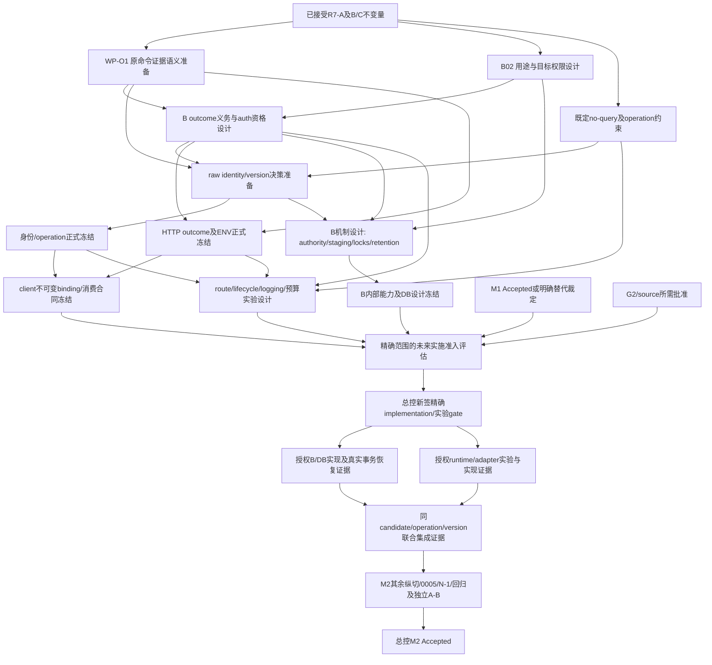

M2_POST_R7_GAP_GATE: DESIGN_ONLY_NEXT_AVAILABLE

# Stage 09P-M2 / Post-R7 Gap Prioritization and Entry Gate

日期：2026-09-06（Asia/Shanghai）。角色：独立 Gate Analyst。结论性质：基于固定仓库事实的只读优先级判断；不是实施准入、合同冻结、Fresh Design Review 或 M2 验收。

## 1. Scope / authority 与判定

现在存在一个安全的设计下一步：**WP-O1「原命令 outcome 与证据范围决策准备包」**，由 HTTP contract owner 单人主责，只产出一份临时 Markdown，随后由总控另行安排独立 Fresh Review。该包是 HTTP/client/outcome contract decision pack 的严格子集；不承担完整 HTTP 协议、客户端 API、B backend 或身份算法的共同设计。

判定依据：B design §8–9、C r1 §8–12 已接受的逻辑约束允许在机制未定时讨论条件能力；C r1 §12 的 G-OUT 是公开结果、客户端 unknown、B 证据交接共同依赖的根语义缺口。现有问题并非缺少一个可随意复用的错误码，而是没有冻结“证据覆盖本次 attempt 还是原逻辑命令”。先明确这一语义，可以减少后续合同、身份和 runtime 设计返工；这项推理不需要 active source、DB、网络或产品运行。

**本轮关闭的实施 blockers 为 0。** 十个 G-* 全部未解除；R7-B/C 仍 IMPLEMENTATION_BLOCKED。WP-O1 的成功上限也仅为一份可独立评审的决策准备材料，不能标为 CONTRACT_FROZEN 或 implementation-ready。

本任务书优先于 AGENTS.md 的通用“阶段完成后更新 docs/project-status.md”约定。本轮不更新该文件，不实施/修复任何仓库内容，不创建任务或委派。模型与推理强度只作为后续任务配置建议，不是模型评测或成本/时效承诺。

标记规则：**已决定/已记录**只用于当前耐久事实及已接受的不变量；**待验证/未冻结**表示仍缺裁定或证据；**仅为假设/建议**用于本报告的排序、候选范围与设计解耦方案。临时材料中的建议不改变已有 Decision state 或 Delivery state。

## 2. PRE：固定基线、材料与阅读

仓库绝对路径：/Users/aipuli/.codex/worktrees/d339/meal-agent-lab。
源分支：refs/heads/codex/stage-09p-m2-inventory。独立分析工作树观察为 detached HEAD；没有切换分支。按任务明确列举的 HEAD/tree/unique parent/branch ref 核验，未用 checkout 名称代替 ref 身份。这与持久 B review §6、C r0 evidence 的独立工作树口径一致；不声称当前 symbolic HEAD 指向该分支。

| PRE 项 | expected = observed | 结论 |
| --- | --- | --- |
| HEAD | 062fc9c5007b9bbf866b6dfa3b1e14309314a451 | PASS |
| tree | 290d90036a2436623009f5cb090702424e798f77 | PASS |
| unique parent | 261f0e3307f4fd9b5134e24b01ae6f461a61b727；恰好一个 | PASS |
| 指定 branch ref | 062fc9c5007b9bbf866b6dfa3b1e14309314a451 | PASS |
| status --porcelain=v1 --untracked-files=all | 空输出 | clean / PASS |

从 docs/evidence/stage-09p-m2/README.md 全文进入十二份持久材料。下表为本轮实际全文 SHA-256，全部等于任务给定值；没有打开历史 /private/tmp 输入或尝试重新恢复材料。

| 引用简称 / 归档文件 | PRE SHA-256 = expected |
| --- | --- |
| A-D / r7a-r6-design.md | 179b4b7066e6bc82d3d99518abe595c6348bb6f26c23b248bc6df2182351e825 |
| A-E / r7a-r6-evidence.md | d9c2b1e41bd87ca9236c5a41c6f29a1350713d304852ba83463152afc996f339 |
| A-R / r7a-r6-fresh-review.md | 1ad22c7258159e2ceba4aa398acf16c62422f17e8536717ab30988ca731c0ebe |
| B-D / r7b-shadow-design.md | 24e1f2496df347a0215041835f45d79ba577256d13d1d6f8e7557e2b53d98d3f |
| B-E / r7b-shadow-evidence.md | 93605e6893e53d8472ccde8a6213f258b7769c22b4a0fbb4e6d4ddb624136b68 |
| B-R / r7b-shadow-fresh-review.md | 7e77977e86cf4b03483f04efb1810c37a4357cc46f97eff54689b4a6b65b1b57 |
| C0-D / r7c-shadow-design-r0.md | 51bf086ce3b8df727f96bb45c3e4724dbb6a12ad1e418079d4c56786306d556e |
| C0-E / r7c-shadow-evidence-r0.md | e7550b9f3120e59957ec02605244011e0d28ed95dc65843a8bcb117c6c2860b9 |
| C0-R / r7c-r0-fresh-review-block.md | 6cacf04593bced1b878a6145590fbe7be7e0d306e1a04f00cba70195bbb7d9d1 |
| C1-D / r7c-shadow-design-r1.md | 4884b06081d009d84461b263e03bfe5c90e82035e325788fcd5b25bb53ad0627 |
| C1-E / r7c-shadow-evidence-r1.md | b592d6aefb17a952b636d5812cd7a01351c78f33d1de2e46ee2a36946b1b1580 |
| C1-R / r7c-r1-fresh-review.md | ca6535848a1bb8d88c9e80ba3eff1f5047d900eeb9fc8889cde37ca94efbec4f |

上述简称均指该仓库 docs/evidence/stage-09p-m2/ 下同名文件；下文 § 编号指原文标题，行号指当前固定 tree。完整阅读：AGENTS.md、README.md、docs/README.md；证据索引；十二份材料全文。十二份的实际长度依次为 75、76、187、424、152、139、369、198、161、409、159、216 行。

状态文档完整读取本任务相关的当前段：docs/project-status.md 1–18、1002–1035，并读取 1037–1052 的外部依赖与内部发布阻断。阶段 09P 计划全文通过分段补读覆盖，重点 §5.5、§6、§7、§9–12；初次合并展示被截断的 79–415 行已单独补读，不把截断输出当全文。历史 09A 长段不作为当前 M1/M2 authority。

补充只读核实：ADR 索引；ADR-0002 的平台/契约/持久化边界；ADR-0003 74–181 的授权、HTTP、key scope；ADR-0004 的预发布例外、receipt、unknown 与重启限制相关段；ADR-0005 279–299 日志/部署边界；ADR-0007 domain/contracts/source 边界；ADR-0008 1–80、238–270 的 owning layer 与 TCB。部分额外 ADR 合并读取展示截断，仅据实际可见段落作定向引用，不声称对这些 ADR 全文重新审计。

源码定向阅读：packages/contracts/src/api.ts 全文、stage09p-input.ts 80–103/459–490、inventory-v2.ts 689–735、seasoning-v1.ts 283–335；services/api/src/app.ts 125–182/199–224/288–341、routes.ts 128–158 及接线检索、utils.ts、database/pool.ts、repository.ts 522–618/690–729/809–872、logging.ts 930–972、log-events.ts 相关符号；apps/client/src/core/api-client.ts 1–115、idempotency.ts 371–415、platform/ports.ts、taro-adapter.ts 15–33、command-registry.ts 相关符号。http.ts/database/schema.ts 仅做 M2 replay 相关符号检索；无匹配是定位观察，不是全库不存在证明。未运行源码、tests 或 OpenAPI 工具。

PRE 在上述材料阅读及第二次 identity/hash 对账后全部通过，未触发 BASELINE_BLOCK/MATERIAL_BLOCK，随后才执行唯一 mktemp。

## 3. 固定状态与静态事实的上限

| 对象 | 已记录的当前事实 | 本轮不得外推 |
| --- | --- | --- |
| M1 | M1_LIMITED_TECHNICAL_ACCEPTANCE_WITH_EXCEPTIONS；Fresh Audit A=CLEAN | 不是 M1 Accepted |
| M1 动态 | household-safety 292/292 仅 LIMITED；B-r1/r2/r3=BLOCK；B-r4 未运行 | 不是 Fresh Audit B CLEAN，不授权 B-r4 |
| G2/source | G2_NOT_ADMITTED；source pack draft/inactive；public trust allowlist empty | 不存在获准 active source/public trust |
| M2 | In Progress；整体未 Accepted | R7 收口不等于 M2 总验收 |
| R7-A | contracts Accepted；实施落点 63d2a0668df3e1291cb3a863327bd5aeed6dd034 | 仅冻结 parser/checkpoint/result 等 contracts |
| R7-B | R7-B_SHADOW_DESIGN_ACCEPTED / IMPLEMENTATION_BLOCKED | persisted lookup、raw bytes、staging 仍 Proposed |
| R7-C | R7-C_SHADOW_DESIGN_ACCEPTED / IMPLEMENTATION_BLOCKED | C0-R BLOCK 保留；C1-R CLEAN 仅为新候选设计审查 |
| R7-C 动态 | T01–T50 全未执行；十个 G-* 全未解除 | 没有 Fastify/Node/socket/Taro/DB outcome 通过记录 |

R7-A 已决定的资源上限保持：1,048,576 UTF-8 bytes/chunk、10,000 logical events、Inventory 17 events/chunk、Seasoning 388 events/chunk；root registry legacy 35/34/35，与两域隔离。replay reasons 的 Inventory 22000–22016、Seasoning 25000–25016 不扩用。

已接受的 no-query 逻辑适用于两域首次发送、retry、receipt recovery 与别名入口，包含裸问号；实际 URL、policy/version 表示、proof 表示和最早 hook 仍未冻结。先有 syntactic query absence 资格，后有 collector/decode/parse/auth/B；query 不加入 body digest，也不作为接受后可忽略的维度。未来允许 query 必须重新设计版本与兼容。

静态核实给出的实际差距：R7-A 接受已物化 string；现有 Fastify bodyLimit 配置不证明 collector 接线。现有 auth helper 锁 session 并更新 last_seen/idle expiry，不能冒充 C 所需的无副作用调度认证。legacy requestHash 排序 object 后序列化，不是原字节身份。现有 client 每次重新 JSON.stringify，允许通用 query；generic 4xx/default 路径会 definite-failure，不能直接接新 replay 的跨 attempt unknown。现有 pool 在 COMMIT 错误后尝试 ROLLBACK，不足以证明 commit 未发生。日志仍读取 caller request ID 和 path。以上都是当前源码事实与限制，不是本轮运行失败，也不是越权修复 legacy 的理由。

## 4. 统一 gap inventory：粒度、去重与 owner

采用 **18 个 M2 技术/决策项 + 2 个外部前置状态节点 = 20 个唯一节点**。十个 G-* 原样保留；8 个 B-* 是本报告的检索别名，不是新增 public code、产品 gate 或批准的合同。P-M1/P-G2 是前置裁定节点，不伪装成 M2 开发任务。一个节点可以影响多个 gate，但只计一次。

primary class 按该节点的**主交付对象/下一不可替代的闭合责任**指定：合同缺口归 CONTRACT_FREEZE_REQUIRED；已接受抽象约束而缺实现能力归 IMPLEMENTATION_ADMISSION_REQUIRED；主要缺真实载体事实归 EXTERNAL_OR_DEPLOYMENT_EVIDENCE；还可先补机制无关比较的决策项归 DESIGN_ONLY_NOW。任何类都不自动获得行动权限。对合同/实施/实测类仍可作只读决策准备；这不把其 primary 改成 DESIGN_ONLY_NOW，也不声称它已关闭。

下表“可逆性”区分临时比较材料（均可撤弃）和正式选择/效果的撤回成本。“public”指是否需要正式跨端网络合同；内部 B/日志能力冻结另列，不能把内部接口自动冒充 public DTO。owner 是责任角色，耐久材料没有给出本轮新的具名任命；最终指派必须由总控完成。

### 4.1 十个 R7-C G-*（全部 open）

| 节点 | 当前缺失事实 / 上游依赖 | 主 owner；正式选择可逆性 | public contract / R7-B capability | 最终真实证据依赖 |
| --- | --- | --- | --- | --- |
| G-ROUTE | URL/method/operation/version/media/header 合同；两域全部入口绑定 no-query；早期 target 资格链未实证。依赖 G-ID、G-LIFE、G-LOG 的联合版本与接线 | HTTP route/contract owner；发布前可调整，存在消费者后有兼容成本 | 是；B须认同operation/policy及可信proof | Node/Fastify真实socket、raw header/target与别名；采用proxy时需该链证据；T42–T50 |
| G-ENV | 域 accepted_chunk/finalized/rejected 与 HTTP success/problem 的关系、receipt metadata/响应相关性未冻结。依赖 G-OUT，再与G-ID/CLIENT/BACKEND核对 | HTTP contract owner；公开后不能静默改意义 | 是；需要B给出原历史receipt的可信含义，A schema不等于commit | HTTP/client合同与实际B receipt对应；Node、Taro及DB集成，不以schema检查代替 |
| G-OUT | attempt无效果、原命令终局无效果、commit、unknown、无响应、timeout/恢复的公开语义和证据范围未冻结。依赖B证据义务、身份等价与receipt权限，具体机制可先抽象 | HTTP contract owner主责；B/client提供约束，公开后高兼容风险 | 是；权威commit/abort/unknown及原命令覆盖能力必需 | DB取消/commit未知/lost-response + HTTP/client跨attempt；T33/34/39–41/47 |
| G-ID | raw-byte仍Proposed；编码/比较/域隔离/解析版本、legacy namespace、旧key的版本兼容未冻结。no-query资格须同版本进入client/B | identity contract owner；持久key一旦使用，不能按新版本重新解释 | 是（跨端身份与兼容）；B ledger比较、receipt/tombstone关联 | Node原字节与同源bundle、Taro exact send、DB历史identity重放；T29/30/35/36/46–49 |
| G-CLIENT | replay专用无query binding、一次序列化、response相关性/unknown latch、取消能力、重启locator恢复均缺正式接口/实现。依赖G-OUT/ENV/ID及B恢复 | client registry/API/ports owner；不可变pending发布后不能重绑 | 是，client/HTTP owner正式冻结；B恢复/entitlement必需 | 真实Taro/获准adapter首次与retry发送、迟到回调、principal切换/重启；不能用fake替代 |
| G-AUTH | parse后B前的无副作用认证/可信调度scope能力不存在可沿用的证明；事务内B授权和撤回fence仍独立。依赖B04及receipt权限规则 | auth owner；身份/权限语义敏感，正式改变须审查 | 内部能力为主；若影响401/403/404/receipt资格则另需public冻结。B决策点重验必需 | DB/session零更新、revocation并发、scope零泄漏、C阶段调用顺序 |
| G-LIFE | 唯一raw hook、raw-target/duplicate header可见性、CL/TE、strict UTF-8/BOM、close/end/abort及cleanup实际偏序。依赖route允许面和B交接边界 | runtime/transport owner；局部实验可弃，平台/部署切换需独立准入 | 不必新增DTO；若改变允许传输/公开行为要合同冻结。dispatch后依赖B | 精确Node/Fastify真实socket；采用proxy/HTTP2时另证；同步单测/inject不替代 |
| G-BUDGET | raw/string/DTO/response/native/target峰值、CPU同步不可抢占、global/scoped/rate/fairness/unknown残余容量和deadline均无数值证据。依赖LIFE、AUTH、BACKEND和B06 | C admission/资源owner；数值需重新取证，worker/process等平台选择不能自行决定 | 公布的限额/恢复行为需合同；内部数值非public DTO。B取消残余/所有权必需 | 真实runtime峰值/最坏工作/公平窗口/执行副本总账；DB未结算工作与慢Taro输出 |
| G-LOG | guard前/后所有sink的固定无输入投影、caller requestId/path/instance/query-derived泄漏仍缺接线和sentinel证据。依赖ROUTE/LIFE同链时序 | 组装根/logging owner；已泄漏信息不能回收 | EventLogSink内部冻结；若调整problem.instance等公开意义，需HTTP owner。B只交安全类别 | Node/framework/application/stderr/client全sink；proxy若采用亦须；T37/T50 |
| G-BACKEND | B可供C消费的outcome、取消确认、原命令恢复资格、bytes/DTO ownership ack、no-query同源proof能力未冻结/实现。依赖OUT/ID/AUTH与B01–B08 | B interface/application owner；实际持久效果不可任意回滚 | 内部B contract先明确；公开投影属于OUT/ENV，不再复制计数。B真实能力本身 | PostgreSQL事务/恢复/权限及C handoff集成；缺proof直接B负例要求业务效果0，不冒充网络B调用0 |

### 4.2 R7-B 独有剩余项与前置裁定

| 节点 | 唯一缺失对象 / 原文依据 | owner / 上游 | public与可逆性 / 必需真实证据 |
| --- | --- | --- | --- |
| B01 checkpoint authority选择 | persisted lookup、digest correlation、MAC的最终取舍；checkpoint canonical bytes/域隔离/版本与轮换、泄漏撤回仍未决。UUID/schema/digest均不产生authority（B-D §4、§11.2、§12.1） | B security/application owner；G-ID、G-AUTH、B05 | 可先作不选型比较；若新增token/claim/公开版本必须另行contracts冻结。最终DB lookup/currentness/跨scope实证必需；MAC不是必选 |
| B02 replay用途/target base | 验证既有历史、重建派生投影、受控导入何者获准；来源权限、base绑定、已有live事件等价/冲突、empty不清live（B-D §5、§8.1、§12.2） | product/domain owner；P-M1/P-G2管真实来源，auth管写权限 | 可先写条件分支/批准义务，不能在本轮选择扩大产品用途。若用途改变operation语义需合同；最终DB base漂移/物化证据 |
| B03 candidate持久化选择 | per-chunk staging与final-only的最终选择、candidate/live隔离、充分恢复依据（B-D §8、§11.1） | B persistence/domain owner；B02、B07、B06 | 比较可逆；表/持久数据选择不可当临时补丁。内部为主，live可见性改变须另裁；最终真实事务/crash证据 |
| B04 物理锁与撤回/GC相容 | isolation、advisory key、missing-row认领、全部writer/revocation/GC同序、取消/commit线性化。固定逻辑总序不等于机制通过（B-D §6、§12.4–5） | DB/authorization owner；B02/03、G-AUTH、G-OUT | 不需要另造public DTO；涉及公开超时/恢复仍归G-OUT。物理协议要新准入；真实PostgreSQL并发/deadlock/rollback证据必需 |
| B05 retention/GC/recovery边界 | session TTL、abandoned终局化、receipt/checkpoint/audit retention、terminal fence与过期后可恢复结果/不可重放边界（B-D §8/10/12.9；B-R §8.9） | B lifecycle owner主责，HTTP contract owner裁公开语义；G-OUT/ID/AUTH、B04 | 过期/不可恢复响应关系必须正式冻结；删除恢复依据难逆。不得照搬legacy 30天配置。最终GC/replay/final并发与fence不失忆实证 |
| B06 持久配额/最终计算容量 | 每户/主体session数、单session/累计存储、receipt/checkpoint规模、final事务预算/公平性（B-D §10、§12.10） | B storage/resource owner；B03/05/07及C预算交界 | 数值待测，非批准配额；public容量意义归ENV/OUT。真实DB/runtime容量与原子计费/拒绝零变化证据；最多10,000小chunks，589/26不是最坏数 |
| B07 全历史确定性验证 | 全历史canonical/digest、增量/恢复算法与before/projection重算关系、跨chunk eventId/commandId防重（B-D I07/I08、§10、§12.11） | domain owner，B消费；B02/03、R7-A；公开digest编码接G-ID/B01 | 可先比较证明义务，不声称已有实现；变更public digest/reason须另冻。最终domain行为及真实持久前缀/崩溃恢复证据必需 |
| B08 DB/0005/N-1实现证据 | schema/约束/RLS/受控权限/manifest、空库与0004升级及N-1恢复均未获M2实施准入（B-D §12.3/12、计划§6/7） | migration/DB owner；P-M1、P-G2适用source面、B02–B07、contracts冻结 | 实现需精确新gate；0000–0004永久冻结；0005名称/内容也须总控确认。不可逆面发布后只roll-forward；真实PostgreSQL权限/恢复证据不可替代 |
| P-M1 前置验收 | M1不是Accepted，Fresh Audit B缺失；292/292不能顶替（project-status当前段、计划§7.1/7.2） | M1总控/独立审计，非本Gate Analyst | M2正式实施仍等待M1 Accepted/Fresh B，或总控明确替代裁定；后者目前不存在，不能从R7-A特批推导通用豁免 |
| P-G2 来源准入 | G2未admitted、source inactive、public trust empty（project-status当前段、B-D §12.13） | source governance/G2总控及具名审核责任人 | 真实source治理/许可/版本/激活不能由纯技术材料替代；需要正式G2 admission及对应批准事实，不只是把allowlist写非空 |

去重映射：B-D §12.6 的 raw identity/key namespace归G-ID，receipt权限归G-AUTH/B05；§12.7 failure/outcome归G-OUT，HTTP envelope归G-ENV；§12.8 stream归G-ROUTE/LIFE/BUDGET；§12.15进程重启恢复归G-CLIENT，属于内部发布阻断，不能转移给“外部设备问题”。B04拥有物理取消/锁机制，G-BACKEND拥有对C的能力交接，G-OUT拥有可公开的证据意义，三者是不同交付物，不把同一lost-response场景算成三个新功能。

根 gap 是：原命令证据语义（G-OUT）、不可变身份/版本（G-ID）、操作用途/来源与target权限（B02、P-M1/P-G2）、可信权限（G-AUTH）、真实B能力（G-BACKEND及B机制）、最早输入/日志/资源的真实载体（G-LIFE）。G-ENV与client disposition主要消费前两项；no-query在七个gate的反复出现是一条联合链，不是七个独立待设计政策。G-LOG既有时序依赖，也有独立隐私风险，不能仅称为文案症状。OpenAPI接入是合同与runtime接线的下游交付，不新增一个“文档已生成即可关闭”的gap。

## 5. 互斥 primary 分类表

缩写只为表格：D=DESIGN_ONLY_NOW；C=CONTRACT_FREEZE_REQUIRED；I=IMPLEMENTATION_ADMISSION_REQUIRED；E=EXTERNAL_OR_DEPLOYMENT_EVIDENCE；M=M1_BLOCKED；G=G2_BLOCKED。E 包含真实本地 Node/Fastify/DB 和真实 adapter 的载体证据，不等于必须上云或现在授权联网。

| 唯一节点 | primary class | secondary dependencies；现在可安全做的最远范围 |
| --- | --- | --- |
| G-ROUTE | C | ID/LIFE/LOG/BACKEND、I/E、M/G；只整理冻结责任/无query输入条件，不选URL或挂route |
| G-ENV | C | OUT/ID/CLIENT/BACKEND、I/E；只比较语义容器与现有schema差异，不产DTO/HTTP映射补丁 |
| G-OUT | C | B outcome能力、身份/授权、I/E；可先完成WP-O1准备，不能自行正式冻结 |
| G-ID | C | ROUTE/OUT/CLIENT/BACKEND、B01/B05、I/E；可比较raw-byte/legacy兼容，保留Proposed |
| G-CLIENT | C | ENV/OUT/ID、auth/retention、I/E；只做immutable binding和消费义务设计，不改ports/registry |
| G-AUTH | I | auth内部冻结、B04/05、OUT、M/G；可写无副作用能力边界比较，不复制现有helper |
| G-LIFE | E | ROUTE、LOG、BUDGET及精确实验准入I；可设计观测点/oracle，不运行socket |
| G-BUDGET | E | LIFE/AUTH/BACKEND、B06、I；只能符号账与实验设计，不能拍板timeout/cap/worker |
| G-LOG | I | 日志内部冻结、ROUTE/LIFE、public instance关系C、E；可画sink/时序与泄漏路径，不改logger |
| G-BACKEND | I | B内部能力冻结、OUT/ID/AUTH、B01–B08、M/G/E；只列能力/证据义务，不造临时backend |
| B01 | D | ID中的public编码C、AUTH、I/E；机制比较与可信来源义务可独立评审，机制仍待批准 |
| B02 | D | 产品用途裁定、public operation语义C、M/G、I/E；只做条件用途/target/source边界，不批准live导入 |
| B03 | D | B02/05/06/07、I/E；仅比较candidate恢复/可见性，不选择表或staging实现 |
| B04 | I | auth/锁设计冻结、B03/05、OUT、M/G/E；可列锁图证明义务，不能选key/isolation或运行DB |
| B05 | C | G-OUT/ID/AUTH、B04、I/E；只准备retention与不可恢复结果的责任表，不定TTL/GC数字 |
| B06 | E | B03/05/07、G-BUDGET、I/M；只建存储放大账/实验oracle，不定配额或做benchmark |
| B07 | D | B02/03、公开编码C、domain准入I、M/G及DB证据E；仅等价性/恢复证明义务，不实现reducer/hash |
| B08 | I | M是实质前提；G管source且当前B准入仍受其阻断；合同/DB设计冻结、E；只提取0005/N-1责任，不写SQL |
| P-M1 | M | 外部审核/独立Fresh B及总控；本轮只登记原状态，不能重跑B-r4 |
| P-G2 | G | 来源/许可/地区/版本/治理角色及总控；本轮只登记，不激活或联网验证 |

互斥计数校验：D=4，C=6，I=5，E=3，M=1，G=1，总计20；其中前置状态2项单列。数字仅校验inventory未重复，不代表工作量、完成率或还需20个任务。D项也没有implementation admission，不能将“可写比较材料”误读为“可关闭G-*”。

M1/G2是否阻断所有下一步：**否，未阻断现有授权范围内的纯文档推理和独立设计评审；是，当前仍阻断R7-B/C正式实施及相关source能力。** M1是计划明文的M2实施前提；G2对真实source/public trust具有直接实质约束，又被当前B/C准入状态共同保留。即使未来某个纯synthetic实验逻辑上不消费source，也必须由总控另签精确实验gate，不得自行声明“与source无关所以现在能跑”。

## 6. 依赖 DAG：逻辑关系与动态证据分层

下图是分析性的依赖 DAG，不是新的产品流程或准入脚本。实线表示设计/冻结输入关系；节点中的“批准”均为未来步骤。no-query 是已决定约束，不是等待重选方案。

图中的 O→ID 是**建议的决策交付顺序**：先明确何种原命令证据需要被身份关联，再挑版本表示。raw-byte对比研究本身不必等待O，B用途和runtime观察方案也可在逻辑上独立准备；本轮只推荐O1，不因此调度并行任务。IF/OF 的最终跨端一致性必须在client冻结前汇合，不能各自宣称完成就绕过共同核对。

动态证据依赖另列，不能把逻辑图中的箭头当成测试已通过：

| 动态链 | 必须先具备 / 不能替代 |
| --- | --- |
| Node/Fastify raw入口 | 精确允许环境和实验gate、明确候选route/no-query/media约束、早日志安全及观测oracle；真实raw target/header/stream，非app.inject |
| Taro/adapter | 已冻结client/HTTP/identity binding及获准adapter环境；真实首次/retry bytes、query/headers、15s/abort事实，非fake平台 |
| B/DB | 精确实现准入、操作用途/授权/身份/持久化/锁与恢复设计；真实commit/rollback/unknown/GC/revocation/RLS；pool catch非证据 |
| C→B联合 | 同candidate、同operation集合、同policy/identity/parser版本和真实B能力；stub只可证明局部接线，不能关闭G-BACKEND或DB outcome |
| no-query联合 | raw target→可信早拒绝/absent来源→同attempt C bundle→B受限入口→client首发/恢复；同时覆盖早日志和target预算。七个相关G-*不能用七份不一致局部报告拼接关闭 |
| 预算最终数值 | 完整heap/native/upstream/response/unknown owner实测后才有可信峰值/最坏工作和公平窗口；1MiB与配置15s不是内存/时延证明 |
| M2总验收 | contracts/domain/DB/HTTP/client/权限并发/N-1与适用09A回归，在同精确完整候选取得所需独立A/B；T01–T50不是M2全部验收清单 |

### 6.1 可能形成的循环与仅设计层解耦

| 表观循环 | 设计层解耦顺序；不含临时实现 |
| --- | --- |
| HTTP outcome等B实现，B实现等公开outcome | 先写commit/零效果/unknown的证据义务及覆盖范围；再由B给出可满足性约束；最后由HTTP owner冻结投影。能力不明就保持未冻结，不用500/409兜底 |
| raw identity等client serializer，client等route/B ledger | 先确定逻辑operation/no-query/原命令相关性不变量；独立比较编码/版本；client和B对同份候选给兼容约束，再共同核对。不能用临时semantic hash过桥 |
| 无副作用auth等B scope，B scope等C调度资格 | 将临时调度证据与事务内HouseholdContext分层；先列零副作用/时效/撤回证明义务，再由auth owner评估能力；B保留最终重验。不给C复用已提交事务context |
| 预算等实现测量，implementation gate又等预算 | 先冻结风险上限的符号关系、观测和中止准则；总控未来另签狭窄实验准入；实測后形成数值裁定，再评估产品接入。实验准入与生产route准入不可互相自证；本轮无实验授权 |
| early raw hook等logging，logging等route模板 | 先定义输入不可到达任何sink的责任图、固定operation/未知路由投影和最早可信点要求，再形成共同观测方案；真实hook尚不可证就阻断，不在handler事后redact |
| receipt无限重放期等GC空间，GC等恢复协议 | 先区分结果可恢复性与终态身份不可复用性，再列retention/过期响应候选和权限义务，最后预算/物理GC取证；不批准无期限存储，也不“删除即新命令” |
| C结束要释放slot，B unknown仍持有bytes/连接 | 先用owner/lease责任表表达未结算工作独立记账和确认移交，后由B/资源owner证明可终止/有界；不设计后台orphan旁路 |
| M2用途设计等active source，M1/G2要消费者证明价值 | 用条件化用途/来源前提描述消费者需求，不引入真实数据、不宣称eligible；治理审查与技术设计证据分开。设计可以先行，source activation只能走原治理gate |

这些循环在本报告分析范围内已通过“义务→设计可满足性→正式冻结→精确实验/实现授权→真实证据”分层为有向关系；这不是对未来真实系统锁图无环或所有实现可行性的证明。

## 7. Critical path 与不可并行点

没有持续时间/资源实测，不能计算日历关键路径。本节给出**最短必要依赖链**，不承诺这是唯一算法或最快交付时间。

设计收敛主链：WP-O1证据范围准备 → 独立Fresh Review与总控处理 → B outcome/auth约束及用途边界 → identity/operation版本、HTTP outcome/ENV分别由owner正式冻结并共同核对 → client immutable binding冻结。B01/03/07比较、runtime观察方案可在逻辑上旁路准备，不能越过共同冻结。

实施主链：P-M1/P-G2等所需前提成立 + 相关contracts/domain/DB设计冻结 → 总控签发精确B/DB implementation gate → B持久化/权限/锁/恢复实现与真实证据 → 精确C/client准入及真实socket/adapter/B集成 → 同candidate/version七gate no-query链与其余三gate收口 → M2其余库存/domain/API/client/0005/N-1与09A适用回归 → 独立A/B + 总控复验 → M2 Accepted。经另行准入的runtime局部实测可与B开发错开，但C→B最终证据必须等真实B能力。

不可并行省略点：公开reason/DTO/HTTP共享合同由对应owner单线冻结；身份/receipt跨版本一致性在client实现前核对；source治理批准在真实source使用前；0005内容确认在SQL/migration前；B权威commit/abort能力在C公开结果与联合验收前；新完整候选被冻结后才可取得该候选的独立A/B。R7-A的特定合同准入不为后续这些共享面提供通用授权。

## 8. 候选工作包比较（均为建议，未执行）

所有可设计候选的共同只读输入：固定Git基线、根约定、当前status/09P计划、十二份持久材料及下表限定源码。唯一允许输出均为未来总控新签任务中新0700临时目录的一份Markdown；无仓库变化。表中模型均为建议配置，不表示已创建任务。独立Review须与包作者不同，针对最终文件hash。

| 候选 | 目标与专属只读输入 | 唯一输出 / 明确不做 | 缩小的gap / 仍保留blockers | owner / 模型推理 / review / 仓库变化 |
| --- | --- | --- | --- | --- |
| HTTP/client/outcome contract decision pack（完整包） | 理清HTTP问题、域result、B outcome和client消费；B-D§8–9、C1-D§8/11–12、api.ts、api-client/idempotency | 一份决策材料；不写DTO/code/route/status映射或client实现 | 可缩小ENV/OUT/CLIENT；仍需ID/AUTH/BACKEND、正式freeze与实测 | 跨HTTP/B/client，完整包过大；GPT-6 Astra/xhigh；需Fresh Review；仓库零变化。只选其WP-O1子包 |
| raw identity + idempotency versioning decision pack | 比较原字节与legacy身份、parser/operation/no-query版本和不可变retry义务；B-D§4.3/12.6、C1-D§11、utils/repository/client | 一份候选比较/兼容义务；不拍板raw-byte、hash算法/namespace/version值或第二DTO | 缩小ID及CLIENT/B01/B05；OUT证据范围、route/auth、真实adapter/DB未解 | identity contract owner；GPT-6 Astra/xhigh；需Fresh Review；零变化。可安全准备但此刻优先级次于O1 |
| auth/scope + backend capability boundary pack | 拆调度认证、事务授权、receipt entitlement与撤回；B-D§4/6/11.3、C1-D§5/9–11、ADR3、repository/pool | 一份能力/证明义务表；不选SQL/RLS/locks/MAC/撤回政策或实现backend | 缩小AUTH/BACKEND/B04/B05；OUT/ID/用途以及M1/G2/真实DB仍阻断 | auth owner；完整“auth+所有backend”过大，若以后选择需再收窄；GPT-6 Astra/xhigh；需Fresh Review；零变化 |
| runtime lifecycle/budget/logging experiment design pack | 把未测能力映射到oracle、观测范围和独立授权边界；C1-D§6–10/13–15、app/logging/ports | 一份实验设计；不写脚本/fixture，不运行Node/socket/Taro，不定timeout/并发数字，不选proxy/worker | 缩小LIFE/BUDGET/LOG及query联合证据计划；正式contracts、B能力、所有实测都保留 | runtime owner；三面完整包过大，后续应限最早target/guard观测等单面；GPT-6 Astra/high；需Fresh Review；零变化 |
| 等待M1/G2不继续 | 保持所有上限，输入status/计划；等待真实前提改变 | 本报告中记录等待条件，无第二输出；不设监控或运行B-r4/G2 | 不缩小技术gap；M1/G2及所有共享合同/能力仍缺 | 总控；无需新模型任务/review；零变化。合法但不是唯一可行路线，当前不推荐全面停工 |
| **WP-O1（唯一推荐）** | 只明确“何种证据可结算原命令”，给出后续正式freeze的问题边界；详见§9 | 一份自然语言决策准备包；无wire schema/code/route或跨owner实现任务 | 只缩小G-OUT的语义准备缺口；给ENV/CLIENT/BACKEND/ID明确输入，所有20节点仍未获正式关闭 | HTTP contract owner单人；GPT-6 Astra/xhigh；必须全新独立Fresh Review；零变化 |

为何不先做raw identity：它能保证两次请求对应同一意图，但不能证明第二次400是否能清除第一次unknown；先修身份概念不会自动解决错误结算。为何不先做auth/backend：它们必须知道需要交付哪一范围的权威结果；把全部能力并入会跨权限与持久化多个owner。为何不先做runtime：C已有50组未来矩阵，继续扩矩阵对公开证据语义没有替代作用。上述是排序判断，不把其他设计包说成不合法。

## 9. 唯一下一步任务书骨架：WP-O1

**建议名称：Stage 09P-M2 / WP-O1 Original-command Outcome Evidence Scope Decision Preparation（DESIGN_ONLY）。**

任务目标：依据已接受B/C不变量，形成一个可由HTTP contract owner提交独立评审的自然语言决策准备包，回答“在首次attempt、原命令已unknown后的retry、无response、取消未确认、历史receipt、身份/版本或权限变化时，哪些证据足以/不足以允许client结算该原命令”。成果明确需要哪些后续正式合同裁定，不完成那些裁定。

主owner：总控指定的HTTP contract owner，单一作者。B interface、client、identity和auth的要求仅从固定材料提取为输入约束；本包不代替这些owner作批准，不创建协作子任务。建议模型 GPT-6 Astra（gpt-6-astra），推理强度 xhigh。理由是多轴证据范围/兼容与跨attempt反例需要充分推理；不需要以实现能力或联网知识证明设计。

精确输入：

1. 总控新签的只读任务书；若沿用本基线，则HEAD/tree/unique parent/branch ref/clean必须精确等于§2；若分支已推进，必须新签完整identity，不能自行沿用旧SHA或切换Git。
2. 仓库AGENTS.md、README.md、docs/README.md；docs/project-status.md当前09P段；阶段09P计划§5.5/6/7/9/10/12；ADR-0003 HTTP/幂等/授权段与ADR-0004 unknown/receipt/重启段。
3. 从持久索引进入十二份材料，使用§2全部hash；语义重点B-D§4.3、§6、§8–9、§12和B-R；C1-D§8–12、T29–T41/T46–T49与C1-R；C0-R只作已闭合历史finding对照。
4. 同一固定tree下packages/contracts/src/api.ts、http.ts、inventory-v2.ts/seasoning-v1.ts的result/reason边界；services/api/src/errors.ts、routes.ts、database/pool.ts、repository.ts相关身份/receipt边界；apps/client/src/core/api-client.ts、idempotency.ts、command-dispatcher.ts、command-registry.ts、platform/ports.ts与taro-adapter.ts。只读取相关段，不运行产品。

唯一输出：PRE通过后，总控任务书规定的一个新0700临时目录内，**一份 WP-O1-outcome-evidence-scope-decision-pack.md**。报告正文含现有事实与引用、证据覆盖矩阵、必要反例、备选语义的得失、未决owner问题和下一正式冻结所需输入；不另写evidence/manifest/script/fixture。输入必须可从固定Git持久材料重取，本报告及历史/tmp路径不作为唯一必需输入。

最小交付问题（只写自然语言，不新增DTO/字段/enum/code/ordinal）：

- 区分HTTP响应是否到达、R7-A解析结果、B持久结果，以及证据覆盖attempt/原命令；首发没有既有unknown与已有unknown的retry必须分开。
- 对原命令的权威commit receipt、当前attempt已知零效果、覆盖全部相关attempt的终局零效果、无法判定/无响应，列出client允许动作及禁止动作；不得把retryable/status布尔分类当证据。
- 覆盖accepted_chunk/finalized/rejected和历史receipt对应关系；区分原业务结果与本地导航/恢复结果，不让GET/current checkpoint替代原receipt。
- 原key/body/binding保持为抽象不可变身份前提；写清formal identity freeze仍待完成，不能自行选raw byte、parser/operation版本值或校验算法。未知版本/不相关response只能保留不确定性，不重新解释旧命令。
- 将auth-suspended/换principal、receipt权限尚未批准、retention后可恢复性、进程重启缺口列为外部能力前提；不在本包裁定撤回政策、TTL或本地持久化机制。
- 比较满足既有不变量的证据表达方向及其正式freeze需求；明确当前A/API schema承载不了哪些意义，不能把internal R7B分类塞进公开reason或fieldErrors。可以得出“尚不能选定载体”的诚实结论。

明确不做：不完整重设计HTTP/client/outcome大包；不冻结/修改public合同、reason、ordinal、DTO、status映射、实际route/operationId；不改R7-A；不选DB/MAC/locks/isolation/timeout/staging/TTL/配额/source策略；不写或运行代码/测试/实验/generator/checker/gate；不启用B-r4/G2/真实source；不更新仓库、Git或status。该任务书骨架为建议，必须由总控签发，不由本Gate Analyst继续执行。

Fresh Review要求：作者封口提供路径、bytes/lines/SHA-256及PRE/POST；由一位全新独立Reviewer在同固定Git与输入hash下完整阅读，不参与作者设计、不修候选、不运行产品。建议同用GPT-6 Astra/xhigh。Reviewer针对每项语义提出反例，独立给CLEAN/BLOCK及P0/P1/P2，CLEAN只指设计准备材料。BLOCK后必须新候选/新hash复审；作者不能自评CLEAN。总控随后才能决定是否接受准备材料、再签正式合同冻结任务。

成功判据：存在有限且自洽的证据覆盖/客户端动作矩阵，以下反例均有书面可核验处置，全部公开/机制选择诚实留给owner；输入/输出身份无漂移；新Fresh Review发现的P0/P1/P2为0且总控接受该准备范围。成功仍不解除G-OUT，不表示任何动态case通过。

必须书面挑战的最小反例：原attempt已commit丢响应后retry得到400/413/415/429或query拒绝；取消/commit竞态且receipt暂查不到；B成功但HTTP序列化失败；历史open receipt与已推进current checkpoint；same key属性顺序/版本变化；401后同principal恢复和换principal；retry deadline耗尽；retention后结果不可恢复但identity不可复用；malformed/不相关success；后端结果已结算后本地导航失败。query变体不得调用B，直接非法B bundle负例只要求业务效果0，两种oracle不混淆。

失败/停止判据：任一基线/hash不符即BLOCK；需要选择新public字段/码、放宽no-query或依赖真实运行才可完成时，登记未决并停止相关结论；任何以本次无效果清除旧unknown、以查无receipt/timeout证明rollback、以GET证明命令结果、以Proposed机制作为现存能力、或跨owner暗中作批准的结论均BLOCK。若无法在此单一问题范围内形成有价值材料，报告范围不足，交回总控裁定，不自行扩大成完整协议设计。

## 10. M2剩余阶段口径

| 依赖阶段 | 当前口径 | 尚缺的完成条件 |
| --- | --- | --- |
| 已接受设计/有限合同 | R7-A contracts Accepted；B/C shadow design Accepted；no-query逻辑接受 | 不能重复审查同一已闭合query缺口当新进度；接受的是不变量而非runtime能力 |
| 正式合同与机制收敛 | G-ROUTE/ENV/OUT/ID/CLIENT和B公开恢复边界未冻结；B机制仍Proposed | 分owner决策准备、独立review、总控与contract owner正式冻结；domain职责/用途、DB/权限/锁/retention也需明确 |
| 实施准入 | M1 limited、G2 not admitted、B/C implementation blocked | 所需M1/G2前提成立或明确替代裁定，并取得新精确实施范围；不存在沿用R7-A的自动准入 |
| 产品实现 | M2 migration、DB/RLS、完整库存事件/domain与API/client纵切未完成 | FoodConcept绑定、模糊/精确数量、日期来源、开封/冻融/produced、调味品和事件投影按计划实现；R7-B/C仅是其中一部分 |
| 动态证据 | C T01–T50执行0；B事务/权限/恢复未获本次证据 | 真实Node/Fastify/socket/Taro/DB对应证据；0005空库/增量/0004 N-1、permission manifest、并发/RLS/09A适用回归；不能用50个文档条目充当全部M2测试 |
| 总验收 | M2总验收未开始/未完成，整体In Progress | 完整候选精确SHA、clean、所需独立A/B CLEAN、总控复验与正式状态收口；仓库状态更新另行授权执行 |

M2距离完成缺的是这些有序依赖阶段，不能用G-*数、报告行数、过去测试总数或百分比度量。M2 Accepted也不等于M3–M6或09P阶段Pass；真实微信、云、公网和发布仍保留独立外部边界。

## 11. 风险、限制与未执行事项

- 本分析给的是可审计设计顺序，未证明任何物理机制可实现。没有运行时版本/部署链的真实证据，不能将网络/预算可行性写成事实。
- 历史R7-A测试、M1 292/292和09A通过分别有各自claim ceiling。新M2候选变化后仍需相应fresh evidence；设计Review CLEAN不能充当动态Audit B。
- outcome和identity需要在正式冻结时共同核对；选择O1优先不能成为以后忽略key/版本/proof来源的理由。client重启恢复既有内部发布阻断不会被一次文档决策自动完成。
- Proposed raw bytes/persisted lookup/staging、逻辑household总序、symbolic预算都没有被本报告批准；真正SQL/锁/配额/timeout/source选择需原owner和精确准入。
- role owner不等于已安排具体负责人；时间、模型性能、外部审核可用性、最快交付日期未取证。不估算完成率或声称无剩余风险。
- 全文只使用仓库耐久材料/当前源文件与任务给定状态；没有读取历史临时输入、外部网页、真实用户/健康/家庭/食品/凭据数据。
- 未运行Node/pnpm产品tests、Fastify/app.inject/socket/Taro、typecheck/build、generator/checker/gate、DB/SQL/migration/RLS/Docker/N-1、B-r4、G2、联网或外部服务验证；未新建脚本/fixture/manifest；T01–T50保持全部未执行。
- 未修改仓库、十二份材料、docs/project-status.md、任何既有文件；未创建commit/branch/stash/checkout/switch/worktree/push/PR/merge，未创建子任务或委派。唯一写入为下一节的新目录和本报告。

## 12. POST 与交付 identity

唯一目录创建命令：mktemp -d /private/tmp/meal-agent-m2-post-r7-gap-gate.XXXXXX。
实际目录：/private/tmp/meal-agent-m2-post-r7-gap-gate.u2cG1m。
唯一报告绝对路径：/private/tmp/meal-agent-m2-post-r7-gap-gate.u2cG1m/M2-post-r7-gap-gate.md。

POST_RECORD: PASS

报告生成后的POST已实际复核：status porcelain为空；HEAD/tree/唯一parent/指定branch ref与§2逐字一致；十二份持久材料SHA-256与§2逐项一致；目录stat为drwx------ / 700，ls -la确认除目录项外恰好只有本报告一个普通文件。未触发BASELINE_BLOCK或MATERIAL_BLOCK。该组是只读Git身份/hash/文件元数据核对，不是产品checker、gate或动态测试。

本节与尺寸字段补记完成后，执行同组最终只读封口核对，并读取报告全文SHA-256；最终输出记录与交付消息应一致。若最终身份/材料/目录任一项不符，则本次交付必须改报BLOCK且不得继续实施；不能凭上面的首轮POST掩盖后续漂移。

REPORT_BYTES: 000000045917
REPORT_LINES: 000000000323

REPORT_BYTES/REPORT_LINES最终按实际UTF-8字节与换行数记录。最终全文SHA-256在封口后的只读工具输出及最终交付消息给出，不写回本报告制造自引用。报告中的历史材料hash是其真实全文hash；不以规范化摘要冒充本文件全文identity。

本报告封口后不再修改。结论只推荐WP-O1设计准备及其未来独立Fresh Review；其余所有正式合同、implementation、实验、source与验收权限均维持原状态。
